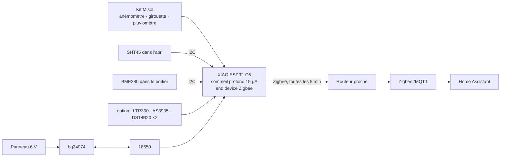

<div align="center">

# 🌦️ Weather Station Zigbee

**Votre propre météo, sur votre propre réseau.** Une station météo Zigbee solaire : vent, pluie, température, humidité, pression, plus des sondes optionnelles d'UV, de lumière, de foudre et de gel.<br>
Seeed XIAO ESP32-C6 + kit météo Misol + abri imprimé en 3D · prête pour Zigbee2MQTT & Home Assistant.

[](https://github.com/mmornati/weather-station-zigbee/actions/workflows/ci.yml)
[](https://mmornati.github.io/weather-station-zigbee/?lang=fr)
[](LICENSE)
<br>
[](https://wiki.seeedstudio.com/xiao_esp32c6_getting_started/)
[](https://www.zigbee2mqtt.io/)
[](https://www.home-assistant.io/)

[**🌐 Site web**](https://mmornati.github.io/weather-station-zigbee/?lang=fr) · [**⚡ Flasher depuis le navigateur**](https://mmornati.github.io/weather-station-zigbee/?lang=fr#flash) · [**📖 Guide de montage**](docs/fr/02-build-guide.md) · [**🖨️ Pièces 3D**](hardware/3d) · [**📦 Versions**](https://github.com/mmornati/weather-station-zigbee/releases)

🌐 [English](README.md) · **Français** · [Italiano](README.it.md)

<a href="https://mmornati.github.io/weather-station-zigbee/?lang=fr"></a> <a href="https://mmornati.github.io/weather-station-zigbee/?lang=fr#parts"></a>

</div>

---

## ✨ Pourquoi celle-ci ?

|   |   |
|---|---|
| ☀️ **Solaire, sans câble** | Une 18650 et un panneau de 1–2 W. Environ 4 mois sur la seule batterie, donc elle va là où les mesures sont justes : en plein jardin |
| 📡 **Zigbee, pas WiFi** | Elle rejoint le maillage de vos autres capteurs. Ni mot de passe ni cloud, et elle continue de fonctionner quand le WiFi du jardin lâche |
| 🌬️ **La panoplie complète** | Vitesse, rafales et direction du vent, pluie, température, humidité, pression |
| ➕ **Modules optionnels** | Indice UV et lumière, distance de la foudre, sonde de gel au ras de l'herbe, température du sol. Détectés au démarrage : ne soudez que ce que vous voulez |
| 🖨️ **Imprimable** | Abri anti-rayonnement, boîtier étanche, support de panneau, colliers de mât, équerres et platine de pluviomètre en OpenSCAD, pour un plateau de 220 × 220 mm |
| 🏠 **Package HA** | Pluie du jour/mois/année, intensité, point de rosée, ressenti, pression au niveau de la mer, Beaufort, alertes gel, rafale, foudre et station muette |
| ✅ **Testé à chaque commit** | Tests unitaires sur l'hôte, deux compilations du firmware, tests du convertisseur avec la bibliothèque de Z2M, vérificateur de configuration de Home Assistant, rendu de chaque STL |

## 🚀 Démarrage rapide

1. **Câblez-la.** Le kit sur `D1` (pluie), `D3` (anémomètre), `D2` (girouette), les capteurs sur l'I2C `D7`/`D8`, la 18650 sur les pastilles BAT du XIAO. [Guide de câblage →](docs/fr/01-hardware-and-wiring.md)
2. **Flashez-la** depuis le [site web](https://mmornati.github.io/weather-station-zigbee/?lang=fr#flash) (Chrome ou Edge), ou :

   ```bash
   cd firmware
   pio run -t erase && pio run -t upload
   ```

3. **Ajoutez le convertisseur.** Copiez [`zigbee2mqtt/weather_station.mjs`](zigbee2mqtt/weather_station.mjs) dans le dossier `external_converters/` de Zigbee2MQTT et redémarrez Z2M.
4. **Appairez-la.** *Permit join* dans Z2M, appuyez sur **RESET** sur la station. Elle reste éveillée 2 minutes pour l'interview. Nommez-la `weather_station`.
5. **Home Assistant.** Copiez [`homeassistant/weather_station.yaml`](homeassistant/weather_station.yaml) dans `/config/packages/` et réglez votre altitude.



## 🧰 Liste des composants

Environ **170–200 €** mât et ~600 g de PETG compris. Liste complète avec notes dans le [guide matériel](docs/fr/01-hardware-and-wiring.md#pièces).

| Pièce | Rôle |
|---|---|
| Seeed XIAO ESP32-C6 + antenne U.FL | MCU + radio Zigbee |
| Kit météo Misol / Fine Offset (SparkFun SEN-15901) | Vitesse et direction du vent, pluie |
| Modules SHT45 + BME280 | Température, humidité, pression |
| Chargeur solaire Adafruit bq24074 + panneau 6 V 1–2 W + 18650 | Énergie |
| *Option :* LTR390, AS3935, 2 × DS18B20 | UV/lumière, foudre, gel, sol |

## 📖 Documentation

| | Guide | Contenu |
|---|---|---|
| 01 | [Matériel & câblage](docs/fr/01-hardware-and-wiring.md) | Pièces, bilan énergétique, schéma, broches |
| 02 | [Montage pas à pas](docs/fr/02-build-guide.md) | Test sur table, impression, boîtier, abri, implantation |
| 03 | [Firmware](docs/fr/03-firmware.md) | Flash, cycle de sommeil, appairage, endpoints, réglages |
| 04 | [Zigbee2MQTT & Home Assistant](docs/fr/04-zigbee2mqtt-and-home-assistant.md) | Convertisseur, entités du package, alertes, remplacer une Netatmo |
| 05 | [Dépannage](docs/fr/05-troubleshooting.md) | Symptômes, causes et solutions |

## 🧪 Qualité

| Vérification | Ce qu'elle prouve |
|---|---|
| **Tests unitaires** (`pio test -e native`) | Décodage de la girouette, moyenne/rafale/direction du vent, anti-rebond du pluviomètre, horloge à travers le sommeil profond, courbe de batterie, conversions de lumière |
| **Compilation PlatformIO** | Le firmware compile pour le XIAO ESP32-C6 en end device Zigbee |
| **Compilation Arduino CLI** | Le même sketch marche dans l'IDE Arduino |
| **Tests du convertisseur** | `zigbee-herdsman-converters`, la bibliothèque de Z2M, reconnaît l'appareil et décode chaque endpoint ; endpoints et modèle correspondent au firmware |
| **Vérification Home Assistant** | Le package passe le `check_config` de Home Assistant |
| **Pièces 3D** | Chaque pièce OpenSCAD se rend en STL sans avertissement |
| **Site web** | Chaque texte du site existe en anglais, en français et en italien ; aucun lien local cassé dans la doc ni sur le site |

Créez une version (`git tag v1.0.0 && git push --tags`) et le [workflow de release](.github/workflows/release.yml) publie le firmware, le convertisseur, le package HA et un zip des STL, avec les sommes de contrôle.

## 🗂️ Organisation du dépôt

```
firmware/
  platformio.ini                 réglages de compilation (carte, end device Zigbee, tests)
  weather_station/weather_station.ino   le sketch
  weather_station/weather_logic.h       logique vent, pluie, girouette, batterie (testée)
  test/                          tests unitaires sur l'hôte
zigbee2mqtt/
  weather_station.mjs            convertisseur externe Zigbee2MQTT
  test/                          tests d'intégration du convertisseur
homeassistant/
  weather_station.yaml           package HA
  ci/                            vérification de la configuration Home Assistant
hardware/3d/                     pièces OpenSCAD, build_stl.sh, render_images.sh
site/                            site web (GitHub Pages) avec le flasheur
docs/                            guides de montage (fr/ et it/ pour les traductions)
```

## 📄 Licence

[MIT](LICENSE) © Marco Mornati. Non affilié à Seeed Studio, Espressif, Misol, Fine Offset, Zigbee2MQTT ou Home Assistant.
