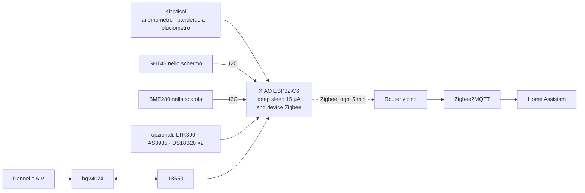

<div align="center">

# 🌦️ Weather Station Zigbee

**Il tuo meteo, sulla tua rete.** Una stazione meteo Zigbee solare: vento, pioggia, temperatura, umidità, pressione, più sonde opzionali per UV, luce, fulmini e gelo.<br>
Seeed XIAO ESP32-C6 + kit meteo Misol + schermo stampato in 3D · pronta per Zigbee2MQTT & Home Assistant.

[](https://github.com/mmornati/weather-station-zigbee/actions/workflows/ci.yml)
[](https://mmornati.github.io/weather-station-zigbee/?lang=it)
[](LICENSE)
<br>
[](https://wiki.seeedstudio.com/xiao_esp32c6_getting_started/)
[](https://www.zigbee2mqtt.io/)
[](https://www.home-assistant.io/)

[**🌐 Sito web**](https://mmornati.github.io/weather-station-zigbee/?lang=it) · [**⚡ Flasha dal browser**](https://mmornati.github.io/weather-station-zigbee/?lang=it#flash) · [**📖 Guida al montaggio**](docs/it/02-build-guide.md) · [**🖨️ Parti 3D**](hardware/3d) · [**📦 Release**](https://github.com/mmornati/weather-station-zigbee/releases)

🌐 [English](README.md) · [Français](README.fr.md) · **Italiano**

<a href="https://mmornati.github.io/weather-station-zigbee/?lang=it"></a> <a href="https://mmornati.github.io/weather-station-zigbee/?lang=it#parts"></a>

</div>

---

## ✨ Perché questa?

|   |   |
|---|---|
| ☀️ **Solare, senza cavi** | Una 18650 e un pannello da 1–2 W. Circa 4 mesi con la sola batteria, così va dove le misure sono giuste: in mezzo al giardino |
| 📡 **Zigbee, non WiFi** | Entra nella mesh dei tuoi altri sensori. Niente password né cloud, e continua a funzionare quando il WiFi in giardino non arriva |
| 🌬️ **Il set completo** | Velocità, raffiche e direzione del vento, pioggia, temperatura, umidità, pressione |
| ➕ **Moduli opzionali** | Indice UV e luce, distanza dei fulmini, sonda del gelo a livello dell'erba, temperatura del suolo. Rilevati all'avvio: saldi solo quelli che vuoi |
| 🖨️ **Stampabile** | Schermo solare, scatola stagna, supporto del pannello, staffe per il palo, squadrette e piastra del pluviometro in OpenSCAD, per un piano da 220 × 220 mm |
| 🏠 **Package HA** | Pioggia di oggi/mese/anno, intensità, punto di rugiada, temperatura percepita, pressione al livello del mare, Beaufort, avvisi di gelo, raffiche, fulmini e stazione muta |
| ✅ **Testata a ogni commit** | Test unitari sull'host, due build del firmware, test del converter con la libreria di Z2M, controllo di configurazione di Home Assistant, ogni STL generato |

## 🚀 Avvio rapido

1. **Collegala.** Il kit su `D1` (pioggia), `D3` (anemometro), `D2` (banderuola), i sensori sull'I2C `D7`/`D8`, la 18650 sui pad BAT dello XIAO. [Guida ai collegamenti →](docs/it/01-hardware-and-wiring.md)
2. **Flashala** dal [sito web](https://mmornati.github.io/weather-station-zigbee/?lang=it#flash) (Chrome o Edge), oppure:

   ```bash
   cd firmware
   pio run -t erase && pio run -t upload
   ```

3. **Aggiungi il converter.** Copia [`zigbee2mqtt/weather_station.mjs`](zigbee2mqtt/weather_station.mjs) nella cartella `external_converters/` di Zigbee2MQTT e riavvia Z2M.
4. **Abbinala.** *Permit join* in Z2M, premi **RESET** sulla stazione. Resta sveglia 2 minuti per l'interview. Chiamala `weather_station`.
5. **Home Assistant.** Copia [`homeassistant/weather_station.yaml`](homeassistant/weather_station.yaml) in `/config/packages/` e imposta la tua altitudine.



## 🧰 Distinta base

Circa **170–200 €** compresi il palo e ~600 g di PETG. Elenco completo con note nella [guida hardware](docs/it/01-hardware-and-wiring.md#componenti).

| Componente | Ruolo |
|---|---|
| Seeed XIAO ESP32-C6 + antenna U.FL | MCU + radio Zigbee |
| Kit meteo Misol / Fine Offset (SparkFun SEN-15901) | Velocità e direzione del vento, pioggia |
| Moduli SHT45 + BME280 | Temperatura, umidità, pressione |
| Caricatore solare Adafruit bq24074 + pannello 6 V 1–2 W + 18650 | Alimentazione |
| *Opzionali:* LTR390, AS3935, 2 × DS18B20 | UV/luce, fulmini, gelo, suolo |

## 📖 Documentazione

| | Guida | Contenuto |
|---|---|---|
| 01 | [Hardware & collegamenti](docs/it/01-hardware-and-wiring.md) | Componenti, bilancio energetico, schema, pin |
| 02 | [Montaggio passo passo](docs/it/02-build-guide.md) | Prova al banco, stampa, scatola, schermo, posizionamento |
| 03 | [Firmware](docs/it/03-firmware.md) | Flash, ciclo di sonno, abbinamento, endpoint, impostazioni |
| 04 | [Zigbee2MQTT & Home Assistant](docs/it/04-zigbee2mqtt-and-home-assistant.md) | Converter, entità del package, avvisi, sostituire una Netatmo |
| 05 | [Risoluzione problemi](docs/it/05-troubleshooting.md) | Sintomi, cause e soluzioni |

## 🧪 Qualità

| Controllo | Cosa dimostra |
|---|---|
| **Test unitari** (`pio test -e native`) | Decodifica della banderuola, media/raffica/direzione del vento, antirimbalzo del pluviometro, orologio attraverso il deep sleep, curva della batteria, conversioni della luce |
| **Build PlatformIO** | Il firmware compila per lo XIAO ESP32-C6 come end device Zigbee |
| **Build Arduino CLI** | Lo stesso sketch funziona con l'IDE Arduino |
| **Test del converter** | `zigbee-herdsman-converters`, la libreria di Z2M, riconosce il dispositivo e decodifica ogni endpoint; endpoint e modello corrispondono al firmware |
| **Controllo Home Assistant** | Il package supera il `check_config` di Home Assistant |
| **Parti 3D** | Ogni parte OpenSCAD genera l'STL senza avvisi |
| **Sito web** | Ogni testo del sito esiste in inglese, francese e italiano; nessun link locale rotto nella documentazione o nel sito |

Crea una versione (`git tag v1.0.0 && git push --tags`) e il [workflow di release](.github/workflows/release.yml) pubblica il firmware, il converter, il package HA e uno zip degli STL, con i checksum.

## 🗂️ Struttura del repository

```
firmware/
  platformio.ini                 impostazioni di build (scheda, end device Zigbee, test)
  weather_station/weather_station.ino   lo sketch
  weather_station/weather_logic.h       logica di vento, pioggia, banderuola, batteria (testata)
  test/                          test unitari sull'host
zigbee2mqtt/
  weather_station.mjs            converter esterno per Zigbee2MQTT
  test/                          test di integrazione del converter
homeassistant/
  weather_station.yaml           package HA
  ci/                            controllo della configurazione Home Assistant
hardware/3d/                     parti OpenSCAD, build_stl.sh, render_images.sh
site/                            sito web (GitHub Pages) con il flasher
docs/                            guide al montaggio (fr/ e it/ per le traduzioni)
```

## 📄 Licenza

[MIT](LICENSE) © Marco Mornati. Non affiliato a Seeed Studio, Espressif, Misol, Fine Offset, Zigbee2MQTT o Home Assistant.
