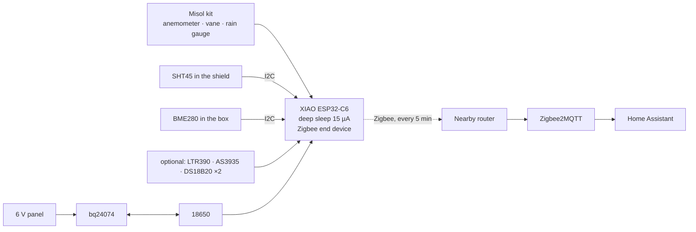

<div align="center">

# 🌦️ Weather Station Zigbee

**Your own weather, on your own network.** A solar Zigbee weather station: wind, rain, temperature, humidity, pressure, plus optional UV, light, lightning and frost probes.<br>
Seeed XIAO ESP32-C6 + Misol weather meter kit + 3D-printed shield · Zigbee2MQTT & Home Assistant ready.

[](https://github.com/mmornati/weather-station-zigbee/actions/workflows/ci.yml)
[](https://mmornati.github.io/weather-station-zigbee/)
[](LICENSE)
<br>
[](https://wiki.seeedstudio.com/xiao_esp32c6_getting_started/)
[](https://www.zigbee2mqtt.io/)
[](https://www.home-assistant.io/)

[**🌐 Website**](https://mmornati.github.io/weather-station-zigbee/) · [**⚡ Flash in your browser**](https://mmornati.github.io/weather-station-zigbee/#flash) · [**📖 Build guide**](docs/02-build-guide.md) · [**🖨️ 3D parts**](hardware/3d) · [**📦 Releases**](https://github.com/mmornati/weather-station-zigbee/releases)

🌐 **English** · [Français](README.fr.md) · [Italiano](README.it.md)

<a href="https://mmornati.github.io/weather-station-zigbee/"></a> <a href="https://mmornati.github.io/weather-station-zigbee/#parts"></a>

</div>

---

## ✨ Why this one?

|   |   |
|---|---|
| ☀️ **Solar, no cables** | One 18650 and a 1–2 W panel. About 4 months on the battery alone, so it goes where the readings are right: in the open garden |
| 📡 **Zigbee, not WiFi** | Joins the mesh your other sensors use. No passwords, no cloud, and it keeps working when the garden WiFi doesn't |
| 🌬️ **The full set** | Wind speed, gusts and direction, rain, temperature, humidity, pressure |
| ➕ **Optional modules** | UV index and light, lightning distance, grass-level frost probe, soil temperature. Detected at boot: solder only what you want |
| 🖨️ **Printable** | Radiation shield, sealed box, panel bracket, pole saddles, angle brackets and rain gauge plate in OpenSCAD, sized for a 220 × 220 mm bed |
| 🏠 **HA package** | Rain today/month/year, rain rate, dew point, feels-like, sea-level pressure, Beaufort, frost, gust, lightning and silent-station alerts |
| ✅ **Tested on every commit** | Host unit tests, two firmware builds, converter tests against Z2M's own library, Home Assistant's config checker, every STL rendered |

## 🚀 Quick start

1. **Wire it.** Kit on `D1` (rain), `D3` (anemometer), `D2` (vane), sensors on I2C `D7`/`D8`, 18650 on the XIAO's BAT pads. [Wiring guide →](docs/01-hardware-and-wiring.md)
2. **Flash it** from the [website](https://mmornati.github.io/weather-station-zigbee/#flash) (Chrome or Edge), or:

   ```bash
   cd firmware
   pio run -t erase && pio run -t upload
   ```

3. **Add the converter.** Copy [`zigbee2mqtt/weather_station.mjs`](zigbee2mqtt/weather_station.mjs) to Zigbee2MQTT's `external_converters/` folder and restart Z2M.
4. **Pair it.** *Permit join* in Z2M, press **RESET** on the station. It stays awake 2 minutes for the interview. Name it `weather_station`.
5. **Home Assistant.** Copy [`homeassistant/weather_station.yaml`](homeassistant/weather_station.yaml) to `/config/packages/` and set your altitude.



## 🧰 Bill of materials

About **€170–200** including the pole and ~600 g of PETG. Full list with notes in the [hardware guide](docs/01-hardware-and-wiring.md#parts).

| Part | Role |
|---|---|
| Seeed XIAO ESP32-C6 + U.FL antenna | MCU + Zigbee radio |
| Misol / Fine Offset weather meter kit (SparkFun SEN-15901) | Wind speed, direction, rain |
| SHT45 + BME280 breakouts | Temperature, humidity, pressure |
| Adafruit bq24074 solar charger + 6 V 1–2 W panel + 18650 | Power |
| *Optional:* LTR390, AS3935, 2 × DS18B20 | UV/light, lightning, frost, soil |

## 📖 Documentation

| | Guide | What's inside |
|---|---|---|
| 01 | [Hardware & wiring](docs/01-hardware-and-wiring.md) | Parts, power budget, wiring diagram, pins |
| 02 | [Step-by-step build](docs/02-build-guide.md) | Bench test, printing, box, shield, siting |
| 03 | [Firmware](docs/03-firmware.md) | Flashing, sleep cycle, pairing, endpoints, settings |
| 04 | [Zigbee2MQTT & Home Assistant](docs/04-zigbee2mqtt-and-home-assistant.md) | Converter, package entities, alerts, replacing a Netatmo |
| 05 | [Troubleshooting](docs/05-troubleshooting.md) | Symptoms, causes and fixes |

## 🧪 Quality

| Check | What it proves |
|---|---|
| **Unit tests** (`pio test -e native`) | Vane decoding, wind average/gust/direction, rain bounce guard, tick clock across deep sleep, battery curve, light conversions |
| **PlatformIO build** | The firmware compiles for the XIAO ESP32-C6 as a Zigbee end device |
| **Arduino CLI build** | The same sketch works for Arduino IDE users |
| **Converter tests** | Z2M's own `zigbee-herdsman-converters` resolves the device and decodes every endpoint; endpoint numbers and model match the firmware |
| **Home Assistant check** | The package passes Home Assistant's own `check_config` |
| **3D parts** | Every OpenSCAD part renders to STL without warnings |
| **Website** | Every string on the website exists in English, French and Italian; no broken local links in the docs or the site |

Tag a version (`git tag v1.0.0 && git push --tags`) and the [release workflow](.github/workflows/release.yml) publishes the firmware, the converter, the HA package and a zip of STL files, with checksums.

## 🗂️ Repository layout

```
firmware/
  platformio.ini                 build settings (board, Zigbee end device, tests)
  weather_station/weather_station.ino   the sketch
  weather_station/weather_logic.h       wind, rain, vane, battery logic (unit tested)
  test/                          host unit tests
zigbee2mqtt/
  weather_station.mjs            Zigbee2MQTT external converter
  test/                          converter integration tests
homeassistant/
  weather_station.yaml           HA package
  ci/                            Home Assistant config check
hardware/3d/                     OpenSCAD parts, build_stl.sh, render_images.sh
site/                            website (GitHub Pages) with the browser flasher
docs/                            build guides
```

## 📄 License

[MIT](LICENSE) © Marco Mornati. Not affiliated with Seeed Studio, Espressif, Misol, Fine Offset, Zigbee2MQTT or Home Assistant.
