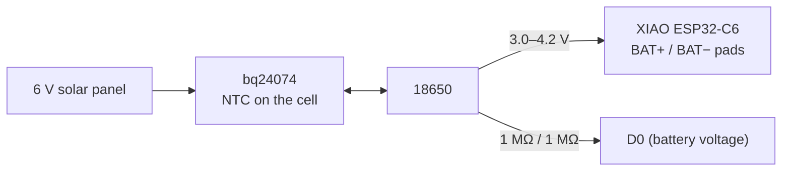

# 01 · Hardware & wiring

🌐 **English** · [Français](fr/01-hardware-and-wiring.md) · [Italiano](it/01-hardware-and-wiring.md)

## Parts

| Part | Role | Notes |
|---|---|---|
| Seeed XIAO ESP32-C6 | Zigbee radio + MCU | ~15 µA in deep sleep; the firmware switches to the external antenna |
| 2.4 GHz U.FL antenna | Range from inside the box | Strongly recommended |
| Misol / Fine Offset weather meter kit (also sold as SparkFun SEN-15901) | Anemometer, vane, tipping-bucket rain gauge | 2.4 km/h per pulse/s, 16-position vane, 0.2794 mm per tip |
| Sensirion SHT45 breakout (I2C, 0x44) | Temperature + humidity, in the radiation shield | ±0.1 °C, ±1 %RH, built-in heater |
| BME280 breakout (I2C, 0x76/0x77) | Pressure + box temperature | Without an SHT45 it becomes the outdoor sensor (then put it in the shield) |
| Adafruit bq24074 solar charger (product 4755) + its 10 kΩ NTC | Solar → Li-ion | Stops charging outside 0–45 °C: Li-ion must not charge below freezing |
| 6 V solar panel, 1–2 W | Energy | 1 W already covers December in northern France |
| 18650 cell (Panasonic NCR18650B) + holder | Storage | ~4 months with no sun at all |
| 2 × 1 MΩ + 100 nF | Battery voltage on `D0` | 2 µA of drain |
| 10 kΩ, 2 × 100 kΩ, 10 nF, 100 nF | Vane divider, reed pull-ups, filters | |
| 2 × RJ11 6P4C PCB jacks | Plug in the kit's cables | |
| 4 × PG7 cable glands, 1 × M12 ePTFE vent plug, 2 mm silicone cord | Seal the box, let it breathe | |
| Pole Ø 32–40 mm, 2–3 m, 8 stainless worm-drive hose clamps, M4/M5 hardware, heat-set inserts | Mounting | M4 × 12 and M4 × 20 + nyloc nuts, 3 × M5 threaded rod, M3/M4/M5 inserts. Plus a short post for the rain gauge |
| *Optional:* LTR390 breakout (I2C, 0x53) + 25 mm PTFE disc, 1 mm | UV index + light | Under the shield's cap |
| *Optional:* 2 × waterproof DS18B20 probe + 2 × 4.7 kΩ | Grass-level (frost) and soil temperature | One probe per pin, no address juggling |
| *Optional:* AS3935 breakout (I2C, 0x03) | Lightning, up to ~40 km | Keep it away from the XIAO and the charger |

## Power



The cell feeds the XIAO's **BAT pads** directly; the XIAO's regulator makes 3.3 V for everything else. The bq24074 charges the same cell from the panel. You can still plug USB into the XIAO to flash it: its own charger only runs while USB is present.

| State | Current | Share of the day |
|---|---|---|
| Deep sleep (XIAO, charger, sensors, divider, anemometer parked on its reed) | 22–55 µA | ~94 % |
| Wind window: 3 s of light sleep every minute | ~3 mA | 5 % |
| Zigbee report every 5 min | ~60 mA for ~2 s | 0.7 % |

About **18–20 mAh a day**: 3400 mAh × 80 % ≈ 4 months with no sun. These are estimates: measure the first one with a USB power meter or a Nordic PPK2.

## Wiring diagram

```
  6 V panel ──► bq24074 IN               bq24074 TS ── 10 k NTC taped to the 18650
               bq24074 BAT ◄──► 18650 + / −
               18650 +  ──► XIAO BAT+ pad          18650 − ──► XIAO BAT− pad

                         XIAO ESP32-C6
  3V3 ── 100 k ──┬── D1  (GPIO1)  ◄── rain reed (RJ11 #2) ── GND     + 100 nF D1 → GND
  3V3 ── 100 k ──┬── D3  (GPIO21) ◄── anemometer reed (RJ11 #1) ── GND + 10 nF D3 → GND
  D9 (GPIO20) ── 10 k ──┬── D2 (GPIO2, ADC) ◄── vane (RJ11 #1) ── GND
  BAT+ ── 1 M ──┬── D0 (GPIO0, ADC) ── 1 M ── GND                     + 100 nF D0 → GND
  3V3 / GND / D7 SDA / D8 SCL ── SHT45 (shield) + BME280 (box) + LTR390 + AS3935
  3V3 ── 4.7 k ──┬── D10 (GPIO18) ── DS18B20 at grass level (data)
  3V3 ── 4.7 k ──┬── D4  (GPIO22) ── DS18B20 in the soil (data)
  U.FL ── external antenna
```

### Pins used by the firmware

| Pin | Function | Notes |
|---|---|---|
| `D0` / GPIO0 | Battery voltage (ADC) | Required: the battery level comes from here |
| `D1` / GPIO1 | Rain gauge reed | Deep-sleep wake source: only GPIO0–7 can wake the C6 |
| `D2` / GPIO2 | Wind vane (ADC) | 10 kΩ to `D9` |
| `D3` / GPIO21 | Anemometer reed | Counted during the 3 s wind windows |
| `D4` / GPIO22 | DS18B20 in the soil | Optional, 4.7 kΩ to `3V3` |
| `D7` / GPIO17, `D8` / GPIO19 | I2C | Same pins as the water meter project; the breakouts carry the pull-ups |
| `D9` / GPIO20 | Vane divider power | High for ~3 ms per reading: no idle current through the vane |
| `D10` / GPIO18 | DS18B20 at grass level | Optional, 4.7 kΩ to `3V3` |
| GPIO3, GPIO14 | RF switch → U.FL antenna | |
| GPIO15 | User LED | Blinks while joining |
| GPIO9 | BOOT button | Hold 3 s after a reset to leave the network |

## Two checks before soldering

1. **RJ11 pinout.** Batches differ. With a multimeter on the wind cable, find the pair that beeps once per turn of the cups (anemometer) and the pair whose resistance changes when you turn the vane (688 Ω to 120 kΩ). On the rain cable, find the pair that beeps when you tip the bucket.
2. **Charger first.** Connect the bq24074 to the cell and the panel, check the cell charges in the sun, *then* connect the XIAO.

## Why these values

- **100 kΩ pull-ups** instead of the internal ~45 kΩ: when the anemometer stops with its reed closed, the pull-up draws current all night. 100 kΩ = 33 µA worst case. The capacitors filter noise on the long kit cables and reed bounce.
- **Vane powered from `D9`**: a vane on a permanent 10 kΩ divider would draw up to 0.3 mA forever.
- **1 MΩ divider**: 2 µA. The 100 nF capacitor gives the ADC a low-impedance source.

Next: [Step-by-step build](02-build-guide.md).
