# 02 · Step-by-step build

🌐 **English** · [Français](fr/02-build-guide.md) · [Italiano](it/02-build-guide.md)

Follow these steps in order. Every part is tested on the bench before it goes outside, so a problem shows up at the desk and not at the top of a pole.

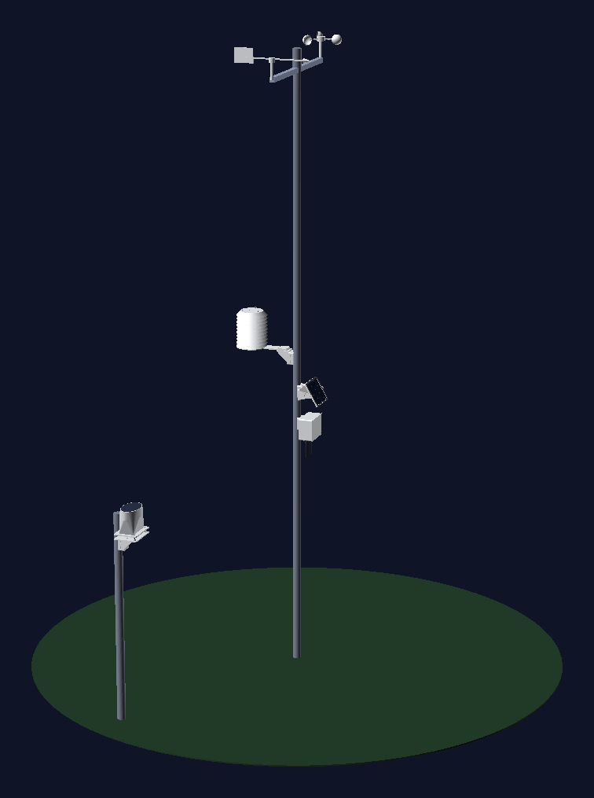 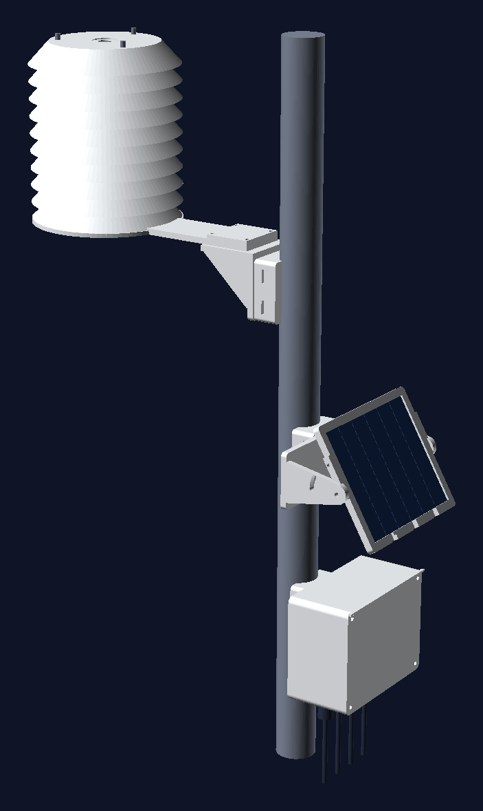

## What you need

- Everything in the [parts list](01-hardware-and-wiring.md#parts) (about €170–200 with the pole and the filament).
- A 3D printer with a 220 × 220 mm bed that prints PETG, a soldering iron with a heat-set insert tip, a multimeter.
- A USB-C cable, a breadboard and some jumper wires for the bench test.
- Optional but useful: a USB power meter or a Nordic PPK2 to check the sleep current, conformal coating spray for the board.

The files you will use:

| What | File |
|---|---|
| Firmware | [`firmware/weather_station/weather_station.ino`](../firmware/weather_station/weather_station.ino), built with [`firmware/platformio.ini`](../firmware/platformio.ini) |
| 3D parts | [`hardware/3d/`](../hardware/3d): one `.scad` file per part, [`build_stl.sh`](../hardware/3d/build_stl.sh) renders all the STL files |
| Zigbee2MQTT converter | [`zigbee2mqtt/weather_station.mjs`](../zigbee2mqtt/weather_station.mjs) |
| Home Assistant package | [`homeassistant/weather_station.yaml`](../homeassistant/weather_station.yaml) |

## 1. Check the kit cables

Weather meter kits change between batches, so measure before you solder anything.

1. Wind cable (the one from the anemometer, with the vane plugged into it): put a multimeter in continuity mode on each pair of wires in the RJ11 plug and turn the cups slowly. The **anemometer pair** beeps once per turn.
2. Still on the wind cable, switch to resistance and turn the vane. The **vane pair** reads between about 688 Ω and 120 kΩ depending on the direction.
3. Rain cable: the **rain pair** beeps each time you tip the bucket by hand.
4. Write the three pairs down. You need them for the RJ11 jacks on the board.

## 2. Check the charger

1. Connect the bq24074 to the 18650 (BAT) and the solar panel (IN). Tape the 10 kΩ NTC to the cell and wire it to TS.
2. Put the panel in the sun. The CHG LED lights and the cell voltage slowly rises.
3. Only then go on: the charger is the one part you can't easily debug once everything is wired.

## 3. Bench test

1. Flash the firmware with the XIAO on USB, from the [website](https://mmornati.github.io/weather-station-zigbee/#flash) or with PlatformIO ([how](03-firmware.md#build-and-flash)). Choose *erase* on the first flash.
2. On a breadboard, wire the kit, the SHT45 and the BME280 as in the [wiring diagram](01-hardware-and-wiring.md#wiring-diagram). Leave the charger out: USB powers everything.
3. Copy the [converter](../zigbee2mqtt/weather_station.mjs) to Zigbee2MQTT's `external_converters/` and restart Z2M. Open *Permit join*.
4. Open the serial monitor (`pio device monitor`) and press **RESET**. You should see the modules detected, the station joining Zigbee2MQTT and a first report.
5. During the 2 minutes the station stays awake after a reset, spin the cups and tip the bucket: the next report shows the wind and the rain.
6. Turn the vane to each direction and check `wind_direction` in Zigbee2MQTT.

If something is missing, see [Troubleshooting](05-troubleshooting.md) before soldering.

## 4. Print the parts

All parts are OpenSCAD files in [`hardware/3d`](../hardware/3d). The defaults fit a 40 mm pole and a 136 × 110 mm panel. To change them, edit `pole_d` in [`common.scad`](../hardware/3d/common.scad) or `panel` in [`panel_bracket.scad`](../hardware/3d/panel_bracket.scad), then run `hardware/3d/build_stl.sh`. Ready-made STL files are on the [website](https://mmornati.github.io/weather-station-zigbee/#parts) and in every release.

| Part | File (`part=`) | Qty | Orientation | Settings |
|---|---|---|---|---|
| 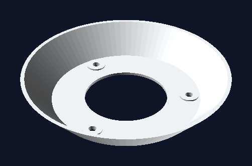 Shield plate | [`radiation_shield.scad`](../hardware/3d/radiation_shield.scad) (`plate`) | 9 | As exported (flat ring down, skirt up at 45°) | White, 2 walls, 15 % |
| 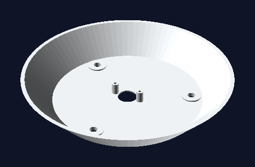 Shield cap | [`radiation_shield.scad`](../hardware/3d/radiation_shield.scad) (`cap`) | 1 | As exported | White, 2 walls, 15 % |
| 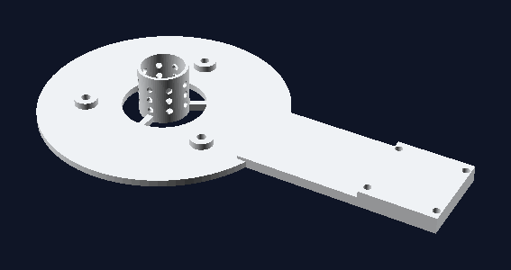 Shield base + arm | [`radiation_shield.scad`](../hardware/3d/radiation_shield.scad) (`base`) | 1 | Flat | 4 walls, 30 % |
| 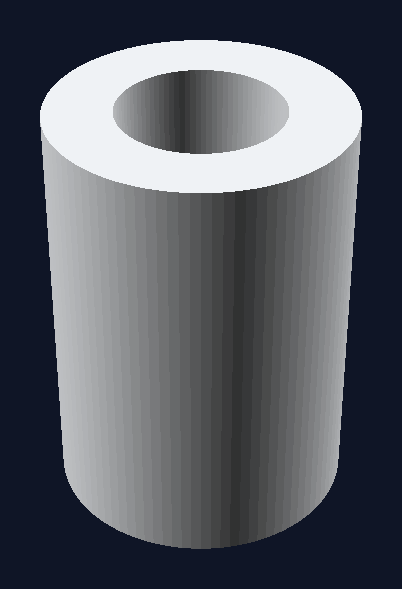 Shield spacer | [`radiation_shield.scad`](../hardware/3d/radiation_shield.scad) (`spacer`) | 30 | Upright | 100 % |
| 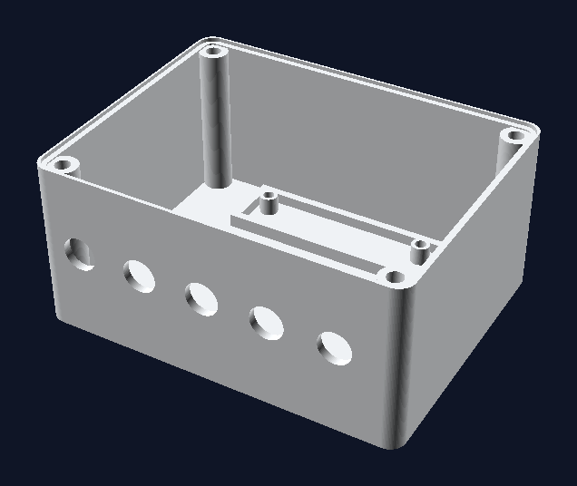 Electronics box | [`electronics_box.scad`](../hardware/3d/electronics_box.scad) (`box`) | 1 | On its back | 4 walls, 30 % |
| 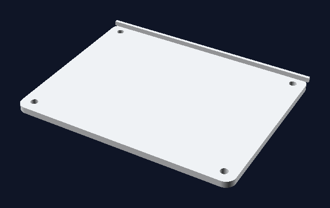 Box lid | [`electronics_box.scad`](../hardware/3d/electronics_box.scad) (`lid`) | 1 | Flat | 4 walls, 30 % |
| 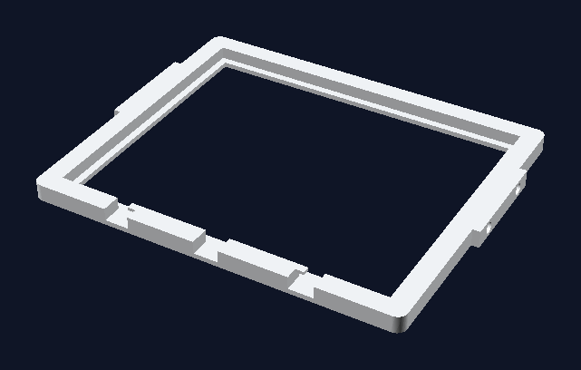 Panel frame | [`panel_bracket.scad`](../hardware/3d/panel_bracket.scad) (`frame`) | 1 | Flat | 4 walls, 30 % |
| 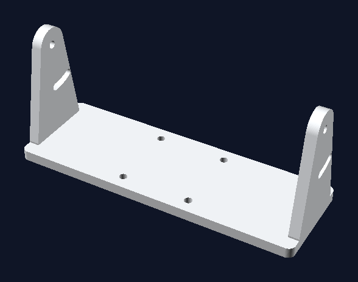 Panel cheeks | [`panel_bracket.scad`](../hardware/3d/panel_bracket.scad) (`cheeks`) | 1 | Base plate down | 4 walls, 40 % |
| 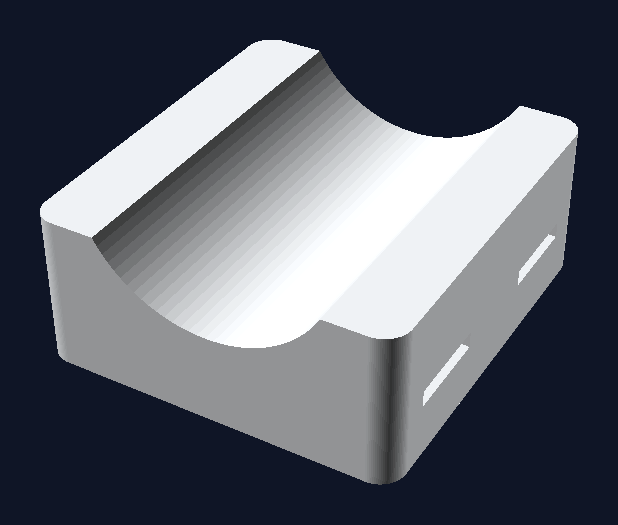 Pole saddle | [`pole_saddle.scad`](../hardware/3d/pole_saddle.scad) | 4 | Flat face down | 6 walls, 40 % |
| 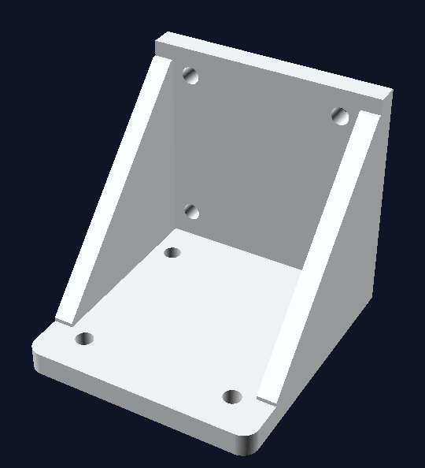 Angle bracket | [`angle_bracket.scad`](../hardware/3d/angle_bracket.scad) | 2 | On its side | 6 walls, 50 % |
| 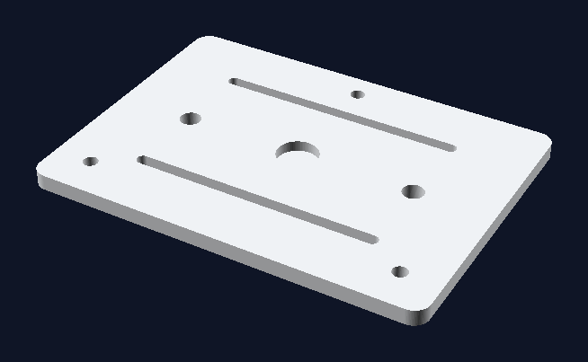 Rain gauge plate, top | [`rain_gauge_plate.scad`](../hardware/3d/rain_gauge_plate.scad) (`top`) | 1 | Flat | 4 walls, 40 % |
| 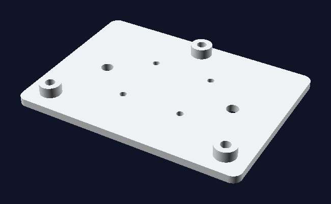 Rain gauge plate, base | [`rain_gauge_plate.scad`](../hardware/3d/rain_gauge_plate.scad) (`base`) | 1 | Flat | 4 walls, 40 % |

- **Material**: PETG (235–245 °C, bed 75–80 °C) in a light colour, or ASA if your hotend handles ~250 °C (the stock Ender 3 V2 Neo hotend is PTFE-lined). Not PLA: it softens in summer sun. Every part fits a 220 × 220 mm bed, with 0.2 mm layers and no supports.
- **Print a test first**: one saddle and the box lid. Check that the saddle sits flat on your pole and that your inserts fit the holes.
- **Heat-set inserts**: M4 × 6 in the saddles and the box's lid bosses, M3 in the box's perfboard posts, M5 (or nuts) in the rain plate base.

## 5. Solder the board

Everything that isn't a module sits on a 70 × 50 mm perfboard with the XIAO. Follow the [wiring diagram](01-hardware-and-wiring.md#wiring-diagram) and the [pin table](01-hardware-and-wiring.md#pins-used-by-the-firmware).

1. Solder the XIAO on female headers, so you can take it out to flash it at the desk.
2. Solder the two RJ11 jacks along one edge, facing the cable glands: RJ11 #1 for the wind cable, #2 for the rain cable, wired to the pairs you found in step 1.
3. Add the parts around the XIAO:
   - 100 kΩ from `3V3` to `D1` and 100 nF from `D1` to `GND` (rain);
   - 100 kΩ from `3V3` to `D3` and 10 nF from `D3` to `GND` (anemometer);
   - 10 kΩ from `D9` to `D2` (vane; the vane's other wire goes to `GND`);
   - 1 MΩ from the battery `+` to `D0`, 1 MΩ from `D0` to `GND`, and 100 nF across the lower one (battery voltage).
4. Add a 4-pin header for the I2C bus (`3V3`, `GND`, `D7` SDA, `D8` SCL). The SHT45 cable to the shield and the BME280 plug into it; the optional LTR390 and AS3935 go on the same bus.
5. Optional DS18B20 probes: data to `D10` (grass level) and `D4` (soil), each with a 4.7 kΩ pull-up to `3V3`.
6. Solder two wires to the XIAO's **BAT+** and **BAT−** pads, underneath the board, for the cell.
7. Check with the multimeter that `3V3` and `GND` are not shorted, then plug in USB and repeat the bench test with the board.
8. Optional: spray conformal coating on the board, keeping it off the RJ11 jacks and the headers.

## 6. Build the box

1. Melt the M3 inserts into the four perfboard posts and the M4 inserts into the four lid bosses.
2. Screw in four **PG7 cable glands** and the **M12 vent plug** in the bottom face. Glands, from left to right: wind, rain, shield sensors, solar panel.
3. Screw the perfboard on its posts, with the RJ11 jacks towards the glands.
4. Fit the 18650 holder in the cradle at the top, the bq24074 and the BME280 next to it. Tape the NTC to the cell.
5. Wire the bq24074's BAT output to the cell holder and to the XIAO's BAT pads. Leave the cell out for now.
6. Route the cables through the glands: the kit's RJ11 cables plug straight into the jacks, the shield's 4-wire cable goes to the I2C header, the panel to the charger's IN.
7. Press the 2 mm silicone cord into the groove of the rim, all the way round, and cut it so the ends just touch.
8. Fit the antenna inside the lid side, away from the battery.

Leave the lid off until the station is on the pole: you'll want to press RESET once it's there.

## 7. Assemble the radiation shield

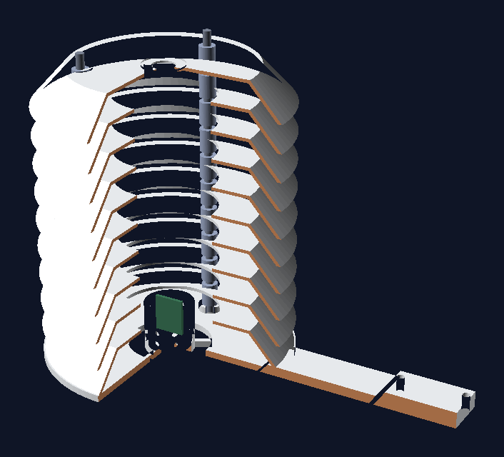

1. Push three **M5 stainless threaded rods** (about 200 mm) through the base and lock them with a nut and washer underneath.
2. Thread a **spacer**, then a **plate** (skirt down), on all three rods. Repeat nine times.
3. Finish with the **cap**. If you fit the LTR390, screw it under the cap's window first and glue the 25 mm PTFE disc into the recess on top.
4. Tighten a nut on each rod over the cap. Don't crush the plates: snug is enough.
5. Pass the SHT45 on a short 4-wire cable up through the hole in the base into the perforated cage, so it hangs in the middle of the stack without touching the walls.

The skirt of each plate covers the gap below it, so neither direct sun nor rain reaches the sensor while air flows freely through.

## 8. Install it

Pick a spot in the open garden, at least 3 m from walls, hedges and paving, and away from the house's warm air.

| Height | What | How |
|---|---|---|
| 3 m | Wind arm (from the kit) | With the kit's own clamp at the top of the pole. Point the vane's **N** mark north (a phone compass is fine) |
| 1.5 m | Radiation shield | On an angle bracket on a saddle, on the **north** side of the pole |
| 1.3 m | Solar panel | On a saddle, facing **south**, tilted about **60°** |
| 1.2 m | Electronics box | On a saddle, glands **down** |
| ~1 m | Rain gauge | On its own short post about 1 m away, on an angle bracket and the levelling plate |

1. Plant the pole vertically (a ground spike or a concrete block). Check it with a level: a leaning pole makes the vane drift.
2. Fit the saddles with two stainless hose clamps each, at the heights above.
3. **Shield**: bolt an angle bracket to its saddle with 4 × M4 × 12 into the inserts, then the shield's arm onto the bracket's shelf with 4 × M4 × 20 and nyloc nuts.
4. **Panel**: bolt the cheeks to their saddle, put the frame between them with an M4 pivot bolt and an M4 bolt in the arc slot, set about 60° and tighten.
5. **Box**: bolt it to its saddle from the inside with 4 × M4 × 12.
6. **Rain gauge**: on its post, saddle, angle bracket, then the plate base on the shelf. Screw the gauge to the top plate, put the three M5 screws and springs between the two plates and adjust them until the bubble is centred.
7. Optional probes: one DS18B20 5 cm above the grass, outside the shield; the other 10 cm deep in the soil.
8. Plug the cables in, put the cell in its holder, and press **RESET** with *Permit join* open in Zigbee2MQTT (the station keeps its pairing from the bench, so it just rejoins).
9. Close the lid with 4 × M4 × 12. Tighten the glands around the cables.

## 9. Final checks

| Do this | Expect |
|---|---|
| Watch Zigbee2MQTT for 10 minutes | A report every 5 minutes, `battery` sensible |
| Spin the cups by hand | `wind_speed` and `wind_gust` above 0 in the next report |
| Pour a glass of water slowly into the gauge | `rain` grows by 0.28 mm per tip |
| Compare `temperature` with a reference in the shade | Within about 0.5 °C |
| Check the Z2M map | The station is an **end device** with a parent router |
| Come back after a sunny day | Battery stays at or near 100 % |

Then add the [Home Assistant package](04-zigbee2mqtt-and-home-assistant.md#home-assistant-package) and set your altitude.

Next: [Firmware](03-firmware.md).
