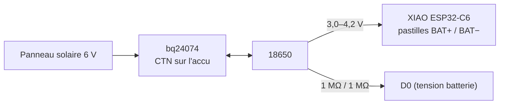

# 01 · Matériel & câblage

🌐 [English](../01-hardware-and-wiring.md) · **Français** · [Italiano](../it/01-hardware-and-wiring.md)

## Pièces

| Pièce | Rôle | Notes |
|---|---|---|
| Seeed XIAO ESP32-C6 | Radio Zigbee + MCU | ~15 µA en sommeil profond ; le firmware bascule sur l'antenne externe |
| Antenne U.FL 2,4 GHz | Portée depuis l'intérieur du boîtier | Vivement conseillée |
| Kit météo Misol / Fine Offset (vendu aussi comme SparkFun SEN-15901) | Anémomètre, girouette, pluviomètre à auget basculant | 2,4 km/h par impulsion/s, girouette à 16 positions, 0,2794 mm par basculement |
| Module Sensirion SHT45 (I2C, 0x44) | Température + humidité, dans l'abri | ±0,1 °C, ±1 %HR, chauffage intégré |
| Module BME280 (I2C, 0x76/0x77) | Pression + température du boîtier | Sans SHT45 il devient le capteur extérieur (mettez-le alors dans l'abri) |
| Chargeur solaire Adafruit bq24074 (produit 4755) + sa CTN 10 kΩ | Solaire → Li-ion | Ne charge pas hors de 0–45 °C : un Li-ion ne doit pas charger sous zéro |
| Panneau solaire 6 V, 1–2 W | Énergie | 1 W couvre déjà décembre dans le nord de la France |
| Accu 18650 (Panasonic NCR18650B) + support | Stockage | ~4 mois sans aucun soleil |
| 2 × 1 MΩ + 100 nF | Tension de batterie sur `D0` | 2 µA de consommation |
| 10 kΩ, 2 × 100 kΩ, 10 nF, 100 nF | Pont de la girouette, tirages des reeds, filtres | |
| 2 × prises RJ11 6P4C pour circuit imprimé | Pour brancher les câbles du kit | |
| 4 × presse-étoupes PG7, 1 × aérateur ePTFE M12, cordon silicone 2 mm | Étanchéité du boîtier, qui respire | |
| Mât Ø 32–40 mm, 2–3 m, 8 colliers de serrage inox, visserie M4/M5, inserts à chaud | Fixation | M4 × 12 et M4 × 20 + écrous nylstop, 3 × tige filetée M5, inserts M3/M4/M5. Plus un petit piquet pour le pluviomètre |
| *Option :* module LTR390 (I2C, 0x53) + disque PTFE 25 mm, 1 mm | Indice UV + lumière | Sous le chapeau de l'abri |
| *Option :* 2 × sonde DS18B20 étanche + 2 × 4,7 kΩ | Température au ras de l'herbe (gel) et du sol | Une sonde par broche, pas de gestion d'adresses |
| *Option :* module AS3935 (I2C, 0x03) | Foudre, jusqu'à ~40 km | À éloigner du XIAO et du chargeur |

## Alimentation



L'accu alimente directement les **pastilles BAT** du XIAO ; le régulateur du XIAO fournit le 3,3 V à tout le reste. Le bq24074 charge ce même accu depuis le panneau. Vous pouvez toujours brancher l'USB sur le XIAO pour le flasher : son propre chargeur ne fonctionne qu'en présence de l'USB.

| État | Courant | Part de la journée |
|---|---|---|
| Sommeil profond (XIAO, chargeur, capteurs, pont, anémomètre arrêté sur son reed) | 22–55 µA | ~94 % |
| Fenêtre de vent : 3 s de sommeil léger chaque minute | ~3 mA | 5 % |
| Envoi Zigbee toutes les 5 min | ~60 mA pendant ~2 s | 0,7 % |

Environ **18–20 mAh par jour** : 3400 mAh × 80 % ≈ 4 mois sans soleil. Ce sont des estimations : mesurez la première station avec un wattmètre USB ou un Nordic PPK2.

## Schéma de câblage

```
  Panneau 6 V ──► bq24074 IN             bq24074 TS ── CTN 10 k scotchée sur la 18650
                 bq24074 BAT ◄──► 18650 + / −
                 18650 +  ──► pastille BAT+ du XIAO    18650 − ──► pastille BAT− du XIAO

                         XIAO ESP32-C6
  3V3 ── 100 k ──┬── D1  (GPIO1)  ◄── reed pluie (RJ11 #2) ── GND       + 100 nF D1 → GND
  3V3 ── 100 k ──┬── D3  (GPIO21) ◄── reed anémomètre (RJ11 #1) ── GND + 10 nF D3 → GND
  D9 (GPIO20) ── 10 k ──┬── D2 (GPIO2, ADC) ◄── girouette (RJ11 #1) ── GND
  BAT+ ── 1 M ──┬── D0 (GPIO0, ADC) ── 1 M ── GND                       + 100 nF D0 → GND
  3V3 / GND / D7 SDA / D8 SCL ── SHT45 (abri) + BME280 (boîtier) + LTR390 + AS3935
  3V3 ── 4,7 k ──┬── D10 (GPIO18) ── DS18B20 au ras de l'herbe (data)
  3V3 ── 4,7 k ──┬── D4  (GPIO22) ── DS18B20 dans le sol (data)
  U.FL ── antenne externe
```

### Broches utilisées par le firmware

| Broche | Fonction | Notes |
|---|---|---|
| `D0` / GPIO0 | Tension de batterie (ADC) | Obligatoire : le niveau de batterie vient d'ici |
| `D1` / GPIO1 | Reed du pluviomètre | Source de réveil du sommeil profond : seuls les GPIO0–7 peuvent réveiller le C6 |
| `D2` / GPIO2 | Girouette (ADC) | 10 kΩ vers `D9` |
| `D3` / GPIO21 | Reed de l'anémomètre | Compté pendant les fenêtres de vent de 3 s |
| `D4` / GPIO22 | DS18B20 dans le sol | Option, 4,7 kΩ vers `3V3` |
| `D7` / GPIO17, `D8` / GPIO19 | I2C | Mêmes broches que le projet compteur d'eau ; les modules portent les résistances de tirage |
| `D9` / GPIO20 | Alimentation du pont de la girouette | Haut pendant ~3 ms par lecture : aucun courant au repos dans la girouette |
| `D10` / GPIO18 | DS18B20 au ras de l'herbe | Option, 4,7 kΩ vers `3V3` |
| GPIO3, GPIO14 | Commutateur RF → antenne U.FL | |
| GPIO15 | LED utilisateur | Clignote pendant l'appairage |
| GPIO9 | Bouton BOOT | À maintenir 3 s après un reset pour quitter le réseau |

## Deux vérifications avant de souder

1. **Brochage RJ11.** Les lots diffèrent. Au multimètre sur le câble du vent, trouvez la paire qui bipe une fois par tour de coupelles (anémomètre) et la paire dont la résistance change quand vous tournez la girouette (688 Ω à 120 kΩ). Sur le câble de pluie, trouvez la paire qui bipe quand vous basculez l'auget.
2. **Le chargeur d'abord.** Branchez le bq24074 sur l'accu et le panneau, vérifiez que l'accu charge au soleil, *puis* branchez le XIAO.

## Pourquoi ces valeurs

- **Tirages de 100 kΩ** au lieu des ~45 kΩ internes : quand l'anémomètre s'arrête reed fermé, la résistance de tirage consomme toute la nuit. 100 kΩ = 33 µA au pire. Les condensateurs filtrent le bruit des longs câbles du kit et les rebonds des reeds.
- **Girouette alimentée par `D9`** : une girouette sur un pont de 10 kΩ permanent consommerait jusqu'à 0,3 mA en continu.
- **Pont de 1 MΩ** : 2 µA. Le condensateur de 100 nF offre à l'ADC une source de faible impédance.

Suite : [Montage pas à pas](02-build-guide.md).
