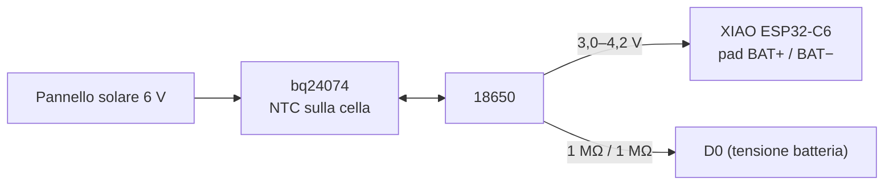

# 01 · Hardware & collegamenti

🌐 [English](../01-hardware-and-wiring.md) · [Français](../fr/01-hardware-and-wiring.md) · **Italiano**

## Componenti

| Componente | Ruolo | Note |
|---|---|---|
| Seeed XIAO ESP32-C6 | Radio Zigbee + MCU | ~15 µA in deep sleep; il firmware passa all'antenna esterna |
| Antenna U.FL 2,4 GHz | Portata dall'interno della scatola | Fortemente consigliata |
| Kit meteo Misol / Fine Offset (venduto anche come SparkFun SEN-15901) | Anemometro, banderuola, pluviometro a vaschetta basculante | 2,4 km/h per impulso/s, banderuola a 16 posizioni, 0,2794 mm per basculata |
| Modulo Sensirion SHT45 (I2C, 0x44) | Temperatura + umidità, nello schermo solare | ±0,1 °C, ±1 %UR, riscaldatore integrato |
| Modulo BME280 (I2C, 0x76/0x77) | Pressione + temperatura della scatola | Senza SHT45 diventa il sensore esterno (allora mettilo nello schermo) |
| Caricatore solare Adafruit bq24074 (prodotto 4755) + il suo NTC da 10 kΩ | Solare → Li-ion | Non carica fuori da 0–45 °C: una Li-ion non va caricata sotto zero |
| Pannello solare 6 V, 1–2 W | Energia | 1 W copre già dicembre nel nord della Francia |
| Cella 18650 (Panasonic NCR18650B) + portabatteria | Accumulo | ~4 mesi senza sole |
| 2 × 1 MΩ + 100 nF | Tensione della batteria su `D0` | 2 µA di consumo |
| 10 kΩ, 2 × 100 kΩ, 10 nF, 100 nF | Partitore della banderuola, pull-up dei reed, filtri | |
| 2 × prese RJ11 6P4C da circuito stampato | Per collegare i cavi del kit | |
| 4 × pressacavi PG7, 1 × tappo di sfiato ePTFE M12, cordino in silicone da 2 mm | Scatola stagna che respira | |
| Palo Ø 32–40 mm, 2–3 m, 8 fascette inox a vite, viteria M4/M5, inserti a caldo | Fissaggio | M4 × 12 e M4 × 20 + dadi autobloccanti, 3 × barra filettata M5, inserti M3/M4/M5. Più un paletto per il pluviometro |
| *Opzionale:* modulo LTR390 (I2C, 0x53) + disco in PTFE da 25 mm, 1 mm | Indice UV + luce | Sotto il cappello dello schermo |
| *Opzionale:* 2 × sonda DS18B20 impermeabile + 2 × 4,7 kΩ | Temperatura a livello dell'erba (gelo) e del suolo | Una sonda per pin, niente indirizzi da gestire |
| *Opzionale:* modulo AS3935 (I2C, 0x03) | Fulmini, fino a ~40 km | Tienilo lontano dallo XIAO e dal caricatore |

## Alimentazione



La cella alimenta direttamente i **pad BAT** dello XIAO; il regolatore dello XIAO fornisce i 3,3 V a tutto il resto. Il bq24074 carica la stessa cella dal pannello. Puoi sempre collegare l'USB allo XIAO per flasharlo: il suo caricatore funziona solo quando c'è l'USB.

| Stato | Corrente | Quota della giornata |
|---|---|---|
| Deep sleep (XIAO, caricatore, sensori, partitore, anemometro fermo sul reed) | 22–55 µA | ~94 % |
| Finestra del vento: 3 s di light sleep ogni minuto | ~3 mA | 5 % |
| Invio Zigbee ogni 5 min | ~60 mA per ~2 s | 0,7 % |

Circa **18–20 mAh al giorno**: 3400 mAh × 80 % ≈ 4 mesi senza sole. Sono stime: misura la prima stazione con un misuratore USB o un Nordic PPK2.

## Schema di collegamento

```
  Pannello 6 V ──► bq24074 IN            bq24074 TS ── NTC 10 k fissato alla 18650
                  bq24074 BAT ◄──► 18650 + / −
                  18650 +  ──► pad BAT+ dello XIAO     18650 − ──► pad BAT− dello XIAO

                         XIAO ESP32-C6
  3V3 ── 100 k ──┬── D1  (GPIO1)  ◄── reed pioggia (RJ11 #2) ── GND     + 100 nF D1 → GND
  3V3 ── 100 k ──┬── D3  (GPIO21) ◄── reed anemometro (RJ11 #1) ── GND + 10 nF D3 → GND
  D9 (GPIO20) ── 10 k ──┬── D2 (GPIO2, ADC) ◄── banderuola (RJ11 #1) ── GND
  BAT+ ── 1 M ──┬── D0 (GPIO0, ADC) ── 1 M ── GND                       + 100 nF D0 → GND
  3V3 / GND / D7 SDA / D8 SCL ── SHT45 (schermo) + BME280 (scatola) + LTR390 + AS3935
  3V3 ── 4,7 k ──┬── D10 (GPIO18) ── DS18B20 a livello dell'erba (data)
  3V3 ── 4,7 k ──┬── D4  (GPIO22) ── DS18B20 nel suolo (data)
  U.FL ── antenna esterna
```

### Pin usati dal firmware

| Pin | Funzione | Note |
|---|---|---|
| `D0` / GPIO0 | Tensione della batteria (ADC) | Obbligatorio: il livello della batteria arriva da qui |
| `D1` / GPIO1 | Reed del pluviometro | Sorgente di risveglio dal deep sleep: solo i GPIO0–7 possono svegliare il C6 |
| `D2` / GPIO2 | Banderuola (ADC) | 10 kΩ verso `D9` |
| `D3` / GPIO21 | Reed dell'anemometro | Contato durante le finestre del vento di 3 s |
| `D4` / GPIO22 | DS18B20 nel suolo | Opzionale, 4,7 kΩ verso `3V3` |
| `D7` / GPIO17, `D8` / GPIO19 | I2C | Stessi pin del progetto contatore dell'acqua; i moduli hanno i loro pull-up |
| `D9` / GPIO20 | Alimentazione del partitore della banderuola | Alto per ~3 ms a lettura: nessuna corrente a riposo nella banderuola |
| `D10` / GPIO18 | DS18B20 a livello dell'erba | Opzionale, 4,7 kΩ verso `3V3` |
| GPIO3, GPIO14 | Commutatore RF → antenna U.FL | |
| GPIO15 | LED utente | Lampeggia durante l'abbinamento |
| GPIO9 | Pulsante BOOT | Tienilo premuto 3 s dopo un reset per uscire dalla rete |

## Due controlli prima di saldare

1. **Piedinatura RJ11.** I lotti cambiano. Con un multimetro sul cavo del vento trova la coppia che fa un bip a ogni giro delle coppette (anemometro) e la coppia la cui resistenza cambia girando la banderuola (da 688 Ω a 120 kΩ). Sul cavo della pioggia trova la coppia che fa bip quando bascula la vaschetta.
2. **Prima il caricatore.** Collega il bq24074 alla cella e al pannello, verifica che la cella si carichi al sole, *poi* collega lo XIAO.

## Perché questi valori

- **Pull-up da 100 kΩ** invece dei ~45 kΩ interni: quando l'anemometro si ferma con il reed chiuso, il pull-up consuma tutta la notte. 100 kΩ = 33 µA nel caso peggiore. I condensatori filtrano il rumore sui lunghi cavi del kit e i rimbalzi dei reed.
- **Banderuola alimentata da `D9`**: una banderuola su un partitore da 10 kΩ sempre acceso consumerebbe fino a 0,3 mA per sempre.
- **Partitore da 1 MΩ**: 2 µA. Il condensatore da 100 nF dà all'ADC una sorgente a bassa impedenza.

Avanti: [Montaggio passo passo](02-build-guide.md).
